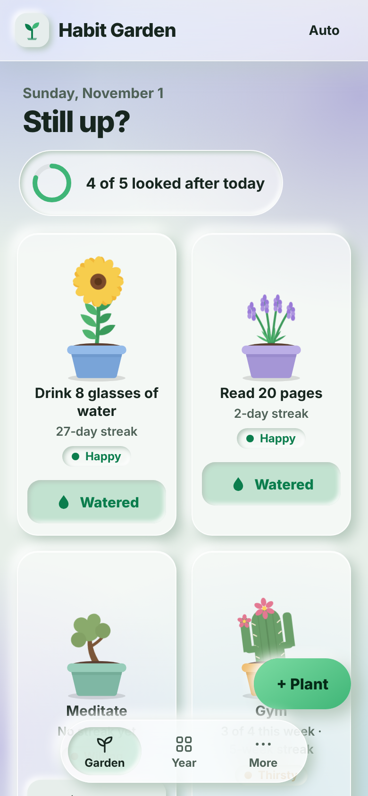
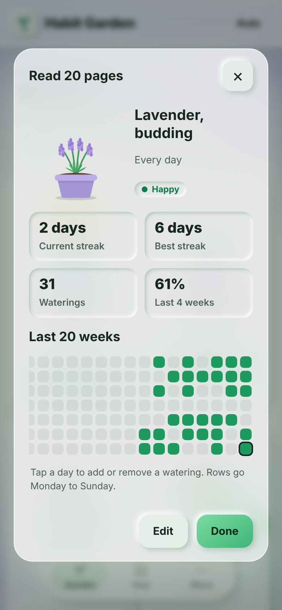
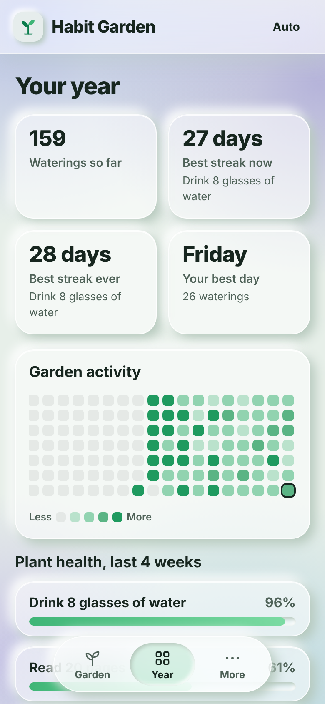
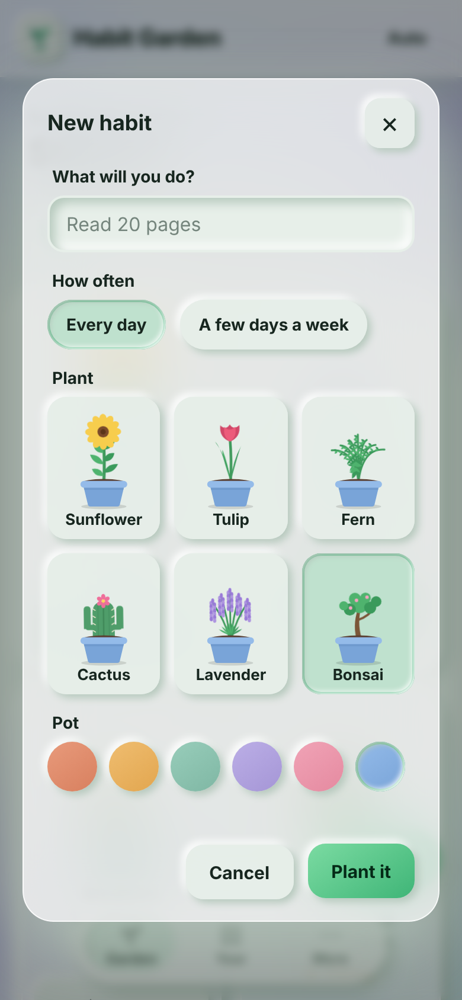
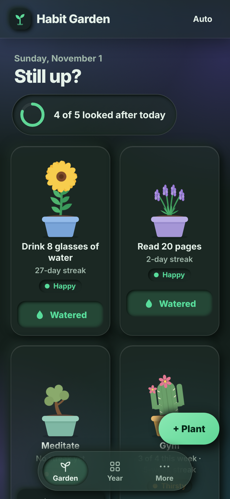

# Habit Garden

**Every habit is a plant in a pot.** Water it when you do the thing, and it grows from a seed to a flourishing plant. Skip a few days and it droops. No account, no server, no tracking: your garden lives in your browser and works offline.

**Try it:** https://jay-m007.github.io/Habit-Garden/ (tap "Try a sample garden" to look around)

| Garden | Habit details | Your year | New habit | Dark |
|---|---|---|---|---|
|  |  |  |  |  |

## What it does

- **Six plants to choose from:** sunflower, tulip, fern, cactus, lavender and bonsai, in six pot colours. Each is drawn in code (SVG) and has six growth stages: seed, sprout, leafy, budding, blooming, flourishing.
- **Daily habits and weekly goals.** "Every day", or "4 days a week". Weekly goals count weeks in a row that hit the target, and a week still in progress never breaks your streak.
- **A plant that shows how you are doing.** Growth follows how well you have looked after it over the last 4 weeks, so one bad day does not wipe your progress. A plant that has not been watered for a while goes thirsty, then wilts (it leans over and its colour fades). The word is written on the card too, so nothing depends on colour alone.
- **Your year at a glance.** A calendar heat map of the whole garden, best streaks, your best day of the week, and a health bar per plant.
- **Fix the past.** Open a habit and tap any of the last 20 weeks to add or remove a watering, for the days you forgot to tick.
- **Reminder.** Pick a time and Habit Garden shows a notification if something still needs water. This only works while the app is open in a tab or added to your home screen, because there is no server to push from.
- **Share a picture of your garden.** One tap makes a PNG on your device.
- **Backup and restore.** Download your garden as a file and load it back on another phone. Restores are checked first, so a wrong file is refused.
- **Works offline and installs to your home screen.** A small service worker keeps it running with no network.
- **Soft glass look, light and dark.** Frosted panels over a colour wash that changes with the time of day, with soft raised and pressed buttons. Follows your phone or set it in the top bar. Reduced motion and reduced transparency are respected.

## Privacy

Nothing leaves your device. There is no backend, no analytics and no network request after the page loads. The page's Content-Security-Policy is `default-src 'none'` with `connect-src 'none'`, so it could not phone home even if the code tried. Habit names are only ever inserted as text, never as HTML, and a backup file is validated field by field before it is loaded.

## How it works

```
engine/   dates.js (day keys, weeks), habits.js (streaks, growth, mood), state.js (saved data and its rules), stats.js (heat map, totals)
web/      index.html, style.css, app.js (screens), plants.js (the six plants as SVG), sw.js (offline), manifest and icons
tests/    node:test, no dependencies
tools/    build.js (copies web/ and engine/ into site/), serve.js (local server)
```

The rules in `engine/` are plain functions with no browser code, so they run under Node for the tests.

- **Streak.** Daily: days in a row, alive while today is still open. Weekly: weeks in a row that met the target.
- **Growth.** Share of expected waterings you actually did over the last 28 days (at least 7), turned into one of six stages.
- **Mood.** Daily: 0 to 1 days since the last watering is happy, 2 to 3 thirsty, 4 or more wilting. Weekly: happy while the goal is still reachable, thirsty when every remaining day is needed, wilting when the week is lost two weeks running.

## Run it

```
npm test            # 15 tests
npm run serve       # builds and serves http://localhost:8080
```

You need Node 20 or newer and nothing else. To host your own copy, fork the repo and turn on GitHub Pages (Settings, Pages, Source: GitHub Actions). The workflow in `.github/workflows/pages.yml` tests, builds and publishes on every push.

## Licence

MIT. See `LICENSE`.
